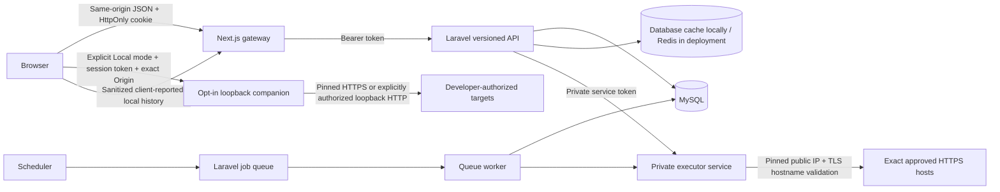

# System architecture

Cloud target requests go through Laravel and the private executor. The gateway only proxies to a fixed, trusted API origin, strips browser cookies from upstream requests, and retains the Sanctum token in an HttpOnly, SameSite=Strict cookie. Mutations require an exact configured public origin. Cookie transport is Secure in production. The token is never placed in browser storage or returned to browser JavaScript.

Local mode is a separate, opt-in browser-to-loopback connection. The Node companion is not launched by the normal developer command. It binds to `127.0.0.1`, requires a one-process random token and exact configured UI origin, and applies DNS/IP checks to public HTTPS targets. Loopback HTTP is available only when the developer starts it with `--allow-localhost`. The browser receives the live response and posts a sanitized, client-reported history record through the normal authenticated gateway; local results are not scheduled monitor results. Encrypted API environment secrets are not disclosed to the browser: the user supplies temporary local values when needed. Detailed boundaries and limits are in `LOCAL_EXECUTION.md`.

Laravel owns validation, authentication, tenant checks, limits, assertions, response redaction and persistence. The executor has only a narrow `/run` contract, operator-controlled hosts and a private service token. Production refuses execution if the isolated service is not configured. A restricted in-process fallback is available only for non-production use; the included local launcher uses the separate service.

Every workspace route passes `WorkspaceAccess`. Membership is required; viewers are read-only. All item queries include `workspace_id`. Related IDs are validated against the same workspace. Only owners can invite users or modify membership. Registration cannot assign platform administration. Audit logs record actions without request contents.

Versioned API: `/api/v1`. Success: `{ "data": ... }`. Errors follow Laravel JSON `{ "message": ..., "errors": ... }` with HTTP 401/403/404/422/429/5xx. Run history wraps paginated results inside `data`. `/api/v1/health` exposes no database credentials or environment information. Operators can review exact-host destination approval requests from the platform console; approval never disables the executor's independent DNS, address, TLS, timeout, redirect or response-size checks.

Queue jobs are unique per monitor, additionally locked during execution, and recheck whether a monitor is enabled and due. A per-workspace lock restricts execution concurrency to one. A database transaction locks the workspace before charging the UTC daily quota. Separate rate-limit keys prevent ordinary API reads from consuming the execution allowance. Failed network attempts are charged; invalid host/template inputs rejected before quota charging are not.

Monitoring stores the request run and monitor relation, advances the next due time, and tracks consecutive failures. Alert rules deduplicate one active incident, and a successful check resolves it. Quota exhaustion postpones a monitor without fabricating a network result. The retention command deletes old runs and cascades their response/assertion records.

Read-only reports contain a fixed seven-day aggregate and up to 50 outcome samples. The token is stored only as a SHA-256 hash and shown once. Revocation and expiry are enforced on every read. Reports contain no workspace request URLs, bodies, variables, or membership data.
